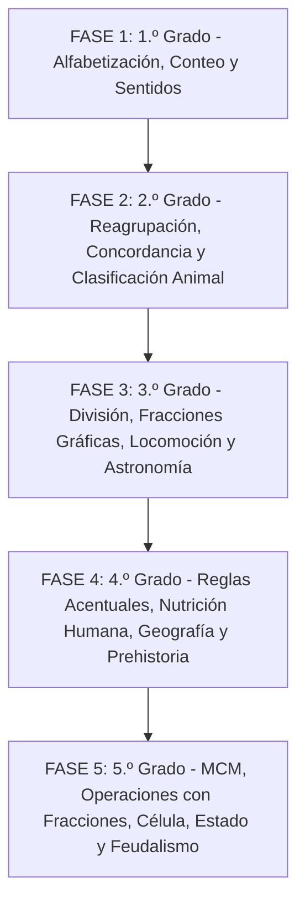

# WORKFLOW PEDAGÓGICO INTEGRAL: EDUCACIÓN PRIMARIA (1.º A 5.º GRADO)

## 1. Arquitectura del Pipeline de Aprendizaje Progresivo
El aprendizaje en la etapa de primaria sigue una progresión cognitiva en espiral estructurada en 5 fases obligatorias:

## 2. Matriz Curricular por Fases y Materias

### 1º Primaria

| Materia | Concepto / Sujeto | Operador | Objeto / Destino | Efecto Pedagógico / Cognitivo | Expresión Formal |
|---|---|---|---|---|---|
| Español | Fonema /s/ | se_representa_por_grafema | Letra 's' | El niño asocia el sonido silbante con el trazo gráfico curvo. | `Fonema(/s/) ↔ Grafema('s')` |
| Español | Unión Consonante + Vocal (m + a) | produce_sílaba_directa | Sílaba 'ma' | La coarticulación produce la primera unidad silábica decodificable. | `Concat('m', 'a') → 'ma'` |
| Español | Sílaba trabada 'bra' | combina_líquida | Oclusiva 'b' + Líquida 'r' + Vocal 'a' | Articulación compleja que requiere mayor control motor del aparato fonador. | `Trabada('b', 'r', 'a') → SílabaCompleja` |
| Español | Inicio de oración | exige_regla_ortográfica | Letra Mayúscula | El estudiante delimita el inicio visual de una unidad con sentido completo. | `InicioOración → GrafemaMayúscula` |
| Español | Punto final de oración | señala_cierre | Pausa total de entonación | Indica el fin del enunciado y la pausa articulatoria antes del siguiente. | `PuntoFinal → CierreEnunciado` |
| Matemáticas | Colección de 10 unidades sueltas | agrupa_en_base_10 | 1 Decena (1D) | Transición crucial del conteo unitario al conteo posicional abstracto. | `Suma(10 * 1U) ≡ 1D` |
| Matemáticas | Operación Adición (a + b) | modela_acción_física | Juntar o avanzar en recta numérica | La suma formaliza la acción concreta de añadir elementos a un conjunto. | `Adición(A, B) ↔ Cardinal(A ∪ B)` |
| Matemáticas | Operación Sustracción (a - b) | modela_acción_física | Quitar o retroceder en la recta | La resta formaliza la separación o el cálculo de diferencia entre cantidades. | `Sustracción(A, B) ↔ Cardinal(A \ B)` |
| Matemáticas | Polígono Triángulo | definido_por | 3 lados rectos y 3 vértices | Identificación visual de la figura geométrica plana indeformable básica. | `Triángulo ⊂ FiguraPlana ∧ Lados(3)` |
| Matemáticas | Aguja horaria en reloj de manecillas | marca_tiempo_cíclico | Horas del día (1 a 12) | Lectura de horas en punto y medias horas mediante división del círculo. | `GiroHorario(AgujaCorta) → Hora` |
| Ciencias Naturales | Órgano Ojo y Retina | sustenta_sentido | Sentido de la Vista | El niño comprende que los ojos son transductores de luz y color hacia el cerebro. | `Ojo ⊂ ReceptorSensorial → PercepciónVisual` |
| Ciencias Naturales | Ser vivo (planta o animal) | cumple_ciclo_vital | Nacer, crecer, reproducirse y morir | Diferenciación ontológica tajante frente a la materia inerte (rocas, plástico). | `SerVivo ⊂ CicloVital(Nacer..Morir)` |
| Ciencias Naturales | Planta terrestre | requiere_factores_abióticos | Agua + Luz solar + Dióxido de carbono + Sustrato | Comprensión de las necesidades biológicas básicas de los vegetales. | `Planta ⊕ (Agua ∧ Luz ∧ Tierra) → Crecimiento` |
| Ciencias Naturales | Animal Herbívoro | posee_régimen_trófico | Consumo exclusivo de materia vegetal | Clasificación inicial por fuente primaria de nutrientes. | `Herbívoro ⊂ ConsumidorPrimario → ComePlantas` |
| Ciencias Sociales | Luz roja en semáforo de peatones | impone_norma_vial | Detención obligatoria del peatón | Interiorización de la regla de seguridad vial para cruzar la calzada. | `LuzRoja(Semáforo) → ProhibidoCruzar` |
| Ciencias Sociales | Ayer vs Hoy vs Mañana | ordena_temporalidad | Secuencia cronológica relativa | Evolución de la noción intuitiva del tiempo hacia la causalidad histórica. | `Ayer < Hoy < Mañana` |
| Ciencias Sociales | Entorno Urbano (Ciudad) | caracterizado_por | Edificios altos, asfalto y alta densidad | Comparación paisajística frente al entorno rural o de campo. | `Ciudad ⊂ PaisajeHumanizado → AltaDensidad` |
| Inglés | Greeting 'Hello / Good morning' | cumple_función_comunicativa | Social greeting upon arrival | Fórmula de cortesía e iniciación interactiva básica. | `'Hello' → SaludoInicial` |
| Inglés | Color name 'Red' | designa_propiedad_visual | Color primario rojo | Asociación directa sonido-objeto sin traducción gramatical previa. | `'Red' ↔ ColorRojo` |
| Inglés | Imperative 'Stand up / Sit down' | ejecuta_comando_TPR | Acción motora corporal inmediata | Método Total Physical Response (comprensión mediante el movimiento físico). | `Command('Stand up') → Levantarse` |

### 2º Primaria

| Materia | Concepto / Sujeto | Operador | Objeto / Destino | Efecto Pedagógico / Cognitivo | Expresión Formal |
|---|---|---|---|---|---|
| Español | Sustantivo Común vs Propio | distingue_semántica | Clase genérica ('perro') vs Nombre individual ('Toby') | Uso obligatorio de mayúscula en nombres propios de personas, ciudades o mascotas. | `SustantivoPropio → MayúsculaObligatoria` |
| Español | Concordancia de Género y Número | impone_coherencia | Artículo + Sustantivo + Adjetivo con igual flexión | Evita errores sintácticos como *'las gato blanco'. | `Concuerda(Art, Sust, Adj, Género, Número)` |
| Español | Regla ortográfica 'm antes de p y b' | norma_fonética | Escribir 'campo' o 'tambor' (nunca 'canpo') | Asimilación del punto de articulación bilabial antes de oclusivas bilabiales. | `Fonema(/m/) + (p/b) → Grafema('m')` |
| Español | Signos de interrogación (¿ ?) | modulan_entonación | Pregunta directa con apertura y cierre | El español requiere signo de apertura inicial obligatorio. | `OraciónInterrogativa → Inicia('¿') ∧ Cierra('?')` |
| Español | Texto instructivo Receta | estructura_información | Lista de ingredientes + Pasos en orden cronológico | Desarrollo de la secuenciación procedimental escrita. | `Receta ≡ Ingredientes + SecuenciaPasos` |
| Matemáticas | Centena (1C) | equivale_a | 10 Decenas (10D) o 100 Unidades (100U) | Ampliación del sistema posicional a números de 3 dígitos (0-999). | `1C ≡ 10D ≡ 100U` |
| Matemáticas | Suma con llevada (Reagrupación) | transfiere_exceso | Unidades $\ge$ 10 pasan como 1 decena a la siguiente columna | Mecanismo algebraico posicional de acarreo. | `Suma(U) ≥ 10 → Acarreo(+1D)` |
| Matemáticas | Multiplicación como suma repetida | abrevia_cálculo | 4 x 3 = 3 + 3 + 3 + 3 | Comprensión del producto como adición de sumandos idénticos. | `Multiplicación(a, b) ≡ ∑_{i=1}^a b` |
| Matemáticas | Propiedad Conmutativa del Producto | establece_invarianza | El orden de los factores no altera el producto | a * b = b * a (ej.: 5 x 2 = 2 x 5 = 10). | `a * b ≡ b * a` |
| Matemáticas | Cuerpo geométrico Cubo | posee_propiedad_3D | 6 caras cuadradas idénticas, 8 vértices y 12 aristas | Transición de figuras 2D planas a cuerpos con volumen 3D. | `Cubo ⊂ PoliedroRegular → Caras(6, Cuadrado)` |
| Ciencias Naturales | Animal Vertebrado | posee_anatomía_interna | Esqueleto óseo y columna vertebral | Diferenciación frente a artrópodos, moluscos y gusanos. | `Vertebrado ⊂ Animalia → ColumnaVertebral` |
| Ciencias Naturales | Clase Mamíferos | caracterizado_por | Vivíparos, glándulas mamarias y cuerpo con pelo | Comprensión de la reproducción interna y lactancia. | `Mamífero ⊂ Vertebrado → MamanLeche ∧ Pelo` |
| Ciencias Naturales | Clase Aves | caracterizado_por | Ovíparos, alas, plumas, pico sin dientes y huesos huecos | Adaptaciones evolutivas directas para el vuelo. | `Ave ⊂ Vertebrado → Plumas ∧ Ovíparo` |
| Ciencias Naturales | Ciclo del Agua: Evaporación | transición_de_fase | Agua líquida se calienta con radiación solar y asciende como gas | Inicio del motor hidrológico terrestre. | `AguaLíquida ⊕ CalorSolar → VaporAguaAscendente` |
| Ciencias Sociales | Puntos Cardinales (N, S, E, O) | establecen_orientación | Norte, Sur, Este (por donde sale el Sol) y Oeste | Comprensión de la rosa de los vientos y orientación espacial universal. | `Orientación ⊂ {Norte, Sur, Este, Oeste}` |
| Ciencias Sociales | Ayuntamiento / Alcaldía local | administra_comunidad | Gestión de servicios públicos, tráfico, limpieza y parques | Introducción a la organización cívica y gobierno de proximidad. | `Ayuntamiento → GestiónServiciosPúblicos` |
| Ciencias Sociales | Curso de un Río | divide_morfología | Curso alto (montaña/rápido), medio (valle/meandros) y bajo (desembocadura) | Geomorfología fluvial básica y dinámica del agua superficial. | `Río ≡ CursoAlto + CursoMedio + Desembocadura` |
| Inglés | Structure 'I like / I don't like' | expresa_preferencia | Afinidad o rechazo hacia alimentos o actividades | Estructura gramatical básica de primera persona. | `'I like' + Noun → ExpresiónGusto` |
| Inglés | Indefinite article 'a' vs 'an' | regla_fonológica | 'a' ante consonante ('a dog') vs 'an' ante vocal ('an apple') | Facilitación de la fluidez articulatoria en inglés. | `ArtIndefinido('a' + Consonante / 'an' + Vocal)` |
| Inglés | Structure 'Have you got...?' | interroga_posesión | Pregunta de pertenencia con respuesta corta ('Yes, I have') | Uso del auxiliar británico para posesión elemental. | `'Have you got' + Noun → PreguntaPosesión` |

### 3º Primaria

| Materia | Concepto / Sujeto | Operador | Objeto / Destino | Efecto Pedagógico / Cognitivo | Expresión Formal |
|---|---|---|---|---|---|
| Español | Oración Bimembre Simple | compuesta_por | Sujeto (quién realiza la acción) + Predicado (la acción) | Estructura sintáctica básica obligatoria. | `Oración ≡ Sujeto + Predicado` |
| Español | Verbo Conjugado | indica_dimensión_temporal | Acción situada en Pasado, Presente o Futuro | Morfema de tiempo y persona en la flexión verbal. | `VerboConjugado → Persona + Número + Tiempo` |
| Español | Sílaba Tónica vs Átona | determina_intensidad | Sílaba con mayor fuerza acústica frente a las relajadas | Fundamento fonológico indispensable antes de aplicar reglas de tildes. | `Palabra ≡ SílabaTónica + SílabasÁtonas` |
| Español | Familia de palabras por derivación | comparte_lexema | Raíz común con prefijos o sufijos añadidos | Ampliación del vocabulario morfológico (mar, marino, marea, submarino). | `Lexema('mar') ⊕ Afijos → FamiliaLéxica` |
| Español | Género literario Fábula | posee_estructura_moral | Personajes animales personificados que transmiten moraleja | Didáctica moral y literatura clásica infantil. | `Fábula ⊂ Narrativa → MoralejaFinal` |
| Matemáticas | Operación División | modela_reparto | Repartir cantidad en partes iguales exactas o con resto | Operación inversa de la multiplicación. | `División(D, d) → c (cociente) ∧ r (resto)` |
| Matemáticas | Prueba de la División | garantiza_consistencia | Dividendo = (Divisor * Cociente) + Resto, con Resto < Divisor | Autoverificación algorítmica obligatoria. | `D ≡ (d * c) + r ∧ r < d` |
| Matemáticas | Fracción elemental (a/b) | representa_parte_todo | b = partes en que se divide el todo, a = partes tomadas | Transición de números enteros discretos a números racionales continuos. | `Fracción(a, b) ≡ a / b` |
| Matemáticas | Ángulo Recto (90°) | define_ortogonalidad | Apertura exacta formada por dos rectas perpendiculares | Clasificación comparativa: agudo (<90°) y obtuso (>90°). | `ÁnguloRecto ≡ 90°` |
| Matemáticas | Gráfico de barras | visualiza_datos | Alturas proporcionales a frecuencias de categorías | Iniciación al análisis e interpretación de datos estadísticos. | `AlturaBarra ∝ FrecuenciaDato` |
| Ciencias Naturales | Aparato Locomotor | funciona_por_coordinación | Huesos rígidos + Articulaciones + Músculos contráctiles | Biomecánica del movimiento voluntario humano. | `Locomoción ≡ Esqueleto + MúsculosAntagónicos` |
| Ciencias Naturales | Proceso de Fotosíntesis | convierte_energía | Agua + CO2 + Luz solar → Glucosa + Oxígeno libre (O2) | Base energética de la vida vegetal y oxigenación planetaria. | `Fotosíntesis: H2O + CO2 + Fotones → C6H12O6 + O2` |
| Ciencias Naturales | Cadena Trófica | describe_flujo_energético | Productores (plantas) → Consumidores (herbívoros/carnívoros) → Descomponedores | Dependencia ecológica y equilibrio del ecosistema. | `FlujoEnergía: Productor → ConsumidorPrimario → ConsumidorSecundario` |
| Ciencias Naturales | Propiedades de la Materia: Masa y Volumen | definen_sustancia | Masa = cantidad de materia (kg); Volumen = espacio ocupado (L) | Introducción a la física fundamental de los cuerpos. | `Materia ≡ Masa ∧ Volumen` |
| Ciencias Sociales | Movimiento de Rotación Terrestre | gira_sobre_eje | Giro de 360° en 24 horas sobre su eje inclinado | Causa directa e invariable de la alternancia entre el día y la noche. | `Rotación(Tierra, 24h) → DíaYNoche` |
| Ciencias Sociales | Movimiento de Traslación Terrestre | orbita_alrededor_sol | Órbita elíptica en 365 días y 6 horas | Junto con la inclinación del eje, origina las cuatro estaciones del año. | `Traslación(Tierra, 365d) ∧ EjeInclinado → CuatroEstaciones` |
| Ciencias Sociales | Sector Económico Primario | extrae_recursos | Agricultura, ganadería, pesca y minería | Obtención directa de materias primas sin transformar. | `SectorPrimario ⊂ Economía → ExtracciónMateriasPrimas` |
| Ciencias Sociales | Globo Terráqueo y Mapamundi | proyectan_geografía | Representación esférica fiel vs Proyección plana de continentes y océanos | Comprensión de la escala planetaria y cartografía básica. | `Mapamundi ≡ ProyecciónPlana(PlanetaTierra)` |
| Inglés | Verb 'To Be' (Present Simple) | indica_identidad_o_estado | I am, You are, He/She/It is, We are, They are | Pilar verbal copulativo fundamental del idioma inglés. | `VerbToBe: am / is / are` |
| Inglés | Existencial 'There is / There are' | señala_existencia | 'There is' para singular y 'There are' para plural | Estructura descriptiva de entornos y habitaciones. | `Existencial('There is' ↔ Singular / 'There are' ↔ Plural)` |
| Inglés | Prepositions of Place (in, on, under, behind) | especifican_ubicación | Relación espacial de un objeto respecto a un contenedor o superficie | Topología espacial en lengua extranjera. | `PreposiciónLugar → UbicaciónRelativa` |

### 4º Primaria

| Materia | Concepto / Sujeto | Operador | Objeto / Destino | Efecto Pedagógico / Cognitivo | Expresión Formal |
|---|---|---|---|---|---|
| Español | Regla de Palabras Agudas | dicta_tilde_si | Terminan en consonante -n, -s o vocal (ej.: camión, compás, papá) | Norma ortográfica de la RAE para palabras oxítonas. | `Aguda ∧ TerminaEn(n/s/vocal) → TildeObligatoria` |
| Español | Regla de Palabras Llanas / Graves | dicta_tilde_si | Terminan en consonante que NO sea -n ni -s (ej.: árbol, lápiz) | Norma ortográfica de la RAE para palabras paroxítonas. | `Llana ∧ ¬TerminaEn(n/s/vocal) → TildeObligatoria` |
| Español | Regla de Palabras Esdrújulas | dicta_tilde_si | Siempre llevan tilde sin excepción (ej.: médico, pájaro) | Regla fija para palabras proparoxítonas. | `Esdrújula → TildeSiempre` |
| Español | Estructura de la Noticia | organiza_periodismo | Titular + Entradilla (qué, quién, cuándo, dónde) + Cuerpo | Técnicas de comunicación informativa y no ficción. | `Noticia ≡ Titular + Entradilla6W + Cuerpo` |
| Español | Recurso Poético: Comparación (Símil) | establece_semejanza | Uso de nexo 'como' o 'parece' ('Tus ojos como el mar') | Iniciación al lenguaje figurado y lírico. | `Símil: ObjetoA + 'como' + ObjetoB` |
| Matemáticas | División por dos cifras en divisor | requiere_algoritmo | Estimación de cifra cociente mediante prueba y resta de productos parciales | Consolidación de cálculo aritmético complejo. | `División2Cifras → EstimaciónCociente ∧ SustracciónParcial` |
| Matemáticas | Número Decimal: Décima y Centésima | extiende_base_10 | 1 décima = 0.1 (1/10); 1 centésima = 0.01 (1/100) | Representación de cantidades fraccionarias en dinero y medidas métricas. | `Décima ≡ 0.1 ∧ Centésima ≡ 0.01` |
| Matemáticas | Perímetro de un Polígono | calcula_contorno | Suma de las longitudes de todos sus lados | Geometría lineal de límites exteriores. | `Perímetro(P) ≡ ∑_{i=1}^n Lado_i` |
| Matemáticas | Triángulo Equilátero vs Isósceles vs Escaleno | clasifica_por_lados | 3 lados iguales vs 2 lados iguales vs 3 lados diferentes | Taxonomía geométrica euclidiana estándar. | `ClasificaciónTriángulos ⊂ {Equilátero, Isósceles, Escaleno}` |
| Matemáticas | Sistema Métrico Decimal: Longitud | escala_por_potencias_10 | 1 km = 1000 m; 1 m = 100 cm; 1 cm = 10 mm | Conversiones de unidades multiplicando o dividiendo por 10. | `1km ≡ 1000m ∧ 1m ≡ 100cm` |
| Ciencias Naturales | Aparato Digestivo | ejecuta_digestión | Masticación bucal → Quimificación estomacal ácida → Absorción intestinal | Descomposición física y enzimática de macronutrientes. | `Digestión: Alimento → Bolo → Quimo → NutrientesAbsorbidos` |
| Ciencias Naturales | Aparato Respiratorio: Alvéolos | realiza_hematosis | El O2 del aire pasa a glóbulos rojos y el CO2 pasa a los alvéolos para exhalar | Intercambio gaseoso pasivo por difusión. | `Hematosis: Alvéolo(O2) ↔ Sangre(CO2)` |
| Ciencias Naturales | Aparato Circulatorio: Corazón | impulsa_circulación | Bomba muscular que envía sangre oxigenada por arterias y recibe desoxigenada por venas | Hemodinámica en circuito cerrado doble y completo. | `Corazón ⊂ BombaCardíaca → FlujoArterialYVenoso` |
| Ciencias Naturales | Aparato Excretor: Riñones | filtra_desechos | Glomérulos filtran urea y toxinas de la sangre produciendo orina líquida | Depuración metabólica y homeostasis hidroelectrolítica. | `Riñones ⊂ FiltroHemático → ProducciónOrina` |
| Ciencias Naturales | Máquina Simple: La Palanca | conserva_trabajo | Fuerza1 * Brazo1 = Fuerza2 * Brazo2 (Ventaja mecánica) | Reducción de fuerza aplicada a expensas de mayor recorrido del brazo. | `Palanca: F1 * d1 = F2 * d2` |
| Ciencias Sociales | Climatología: Tiempo vs Clima | diferencia_escala_temporal | Tiempo = estado actual de atmósfera; Clima = patrón medio de más de 30 años | Diferenciación conceptual crítica frente al cambio estacional. | `Tiempo ≡ EstadoInstantáneo ∧ Clima ≡ Media30Años` |
| Ciencias Sociales | Prehistoria: Paleolítico vs Neolítico | marca_revolución_humana | Nómadas cazadores (fuego/sílex) vs Sedentarios agricultores (poblados/cerámica) | La invención de la agricultura como hito fundacional de la civilización. | `RevoluciónNeolítica: CazaNómada → AgriculturaSedentaria` |
| Ciencias Sociales | Civilización Romana: Romanización | difunde_cultura | Derecho romano, lengua latina, calzadas, acueductos y cristianismo | Legado e infraestructura de la Antigüedad Clásica en Occidente. | `Romanización: Latín + DerechoRomano + ObrasPúblicas` |
| Ciencias Sociales | Constitución y Democracia | regula_estado | Ley fundamental que garantiza derechos, libertades y elecciones populares periódicas | Educación cívica y comprensión del Estado de Derecho. | `Constitución ≡ LeySuprema ∧ Democracia ≡ SoberaníaPopular` |
| Inglés | Present Simple (3rd Person Singular) | añade_sufijo_obligatorio | He/She/It añade -s o -es al verbo (ej.: 'He plays', 'She watches') | Error fosilizable clásico en la adquisición del inglés. | `PresentSimple(He/She/It) → Verbo + 's'/'es'` |
| Inglés | Present Continuous vs Present Simple | contrasta_aspecto_verbal | Acción en progreso ahora ('I am reading') vs Rutina o hábito ('I read every day') | Discriminación de aspectualidad temporal en tiempo presente. | `Aspecto: Continuous('now') vs Simple('routines')` |
| Inglés | Modal verb 'Can / Can't' | expresa_habilidad | Capacidad física o intelectual sin flexión de persona ('I can swim, she can swim') | Uso del primer verbo modal de habilidad y permiso. | `Modal('Can') + InfinitivoSinTo → Habilidad` |

### 5º Primaria

| Materia | Concepto / Sujeto | Operador | Objeto / Destino | Efecto Pedagógico / Cognitivo | Expresión Formal |
|---|---|---|---|---|---|
| Español | Complemento Directo (CD / OD) | recibe_acción_directa | Identificable mediante sustitución por pronombres átonos lo, la, los, las | Análisis sintáctico funcional de oraciones transitivas. | `CD ↔ SustituiblePor('lo', 'la', 'los', 'las')` |
| Español | Complemento Indirecto (CI / OI) | recibe_destinatario_acción | Introducido por preposición 'a' y sustituible por le, les | Distinción funcional sintáctica frente al complemento directo. | `CI ↔ SustituiblePor('le', 'les')` |
| Español | Hiato Acentual (Vocal cerrada tónica) | rompe_diptongo_con_tilde | Vocal cerrada tónica (í, ú) junto a abierta siempre lleva tilde (ej.: ma-rí-a, ba-úl) | Excepción a las reglas generales de agudas/llanas por ley de hiato. | `VocalCerradaTónica + VocalAbierta → TildeObligatoria ∧ Hiato` |
| Español | Conjugación: Modo Indicativo Completo | organiza_tiempos_verbales | Tiempos simples (presente, pretéritos, futuro, condicional) y compuestos | Dominio de la flexión temporal y aspectual del verbo español. | `ModoIndicativo ≡ TiemposSimples + TiemposCompuestos` |
| Español | Género Dramático: El Teatro | presenta_texto_representable | Diálogos directos sin narrador + Acotaciones escénicas entre paréntesis | Diferenciación estructural frente a la narrativa de novela/cuento. | `TextoTeatral ≡ DiálogosPersonajes + AcotacionesEscénicas` |
| Matemáticas | Criterios de Divisibilidad (2, 3, 5) | permiten_descomposición | Divisible por 2 (par), por 3 (suma dígitos = múltiplo 3), por 5 (termina en 0 o 5) | Aritmética rápida para cálculo mental y simplificación. | `Divisibilidad: ReglasRápidas(2, 3, 5)` |
| Matemáticas | Mínimo Común Múltiplo (mcm) | unifica_denominadores | Menor múltiplo común positivo de dos o más números para sumar fracciones heterogéneas | Herramienta obligatoria para adición de fracciones con distinto denominador. | `SumaFracciones(a/b + c/d) → Requiere_mcm(b, d)` |
| Matemáticas | Multiplicación de Fracciones | opera_en_línea | (a/b) * (c/d) = (a * c) / (b * d) | Algoritmo directo multiplicativo de numeradores y denominadores. | `(a/b) * (c/d) ≡ (a*c) / (b*d)` |
| Matemáticas | Área del Triángulo | deduce_mitad_rectángulo | Área = (Base * Altura) / 2 | Comprensión geométrica de que cualquier triángulo ocupa la mitad de su paralelogramo circunscrito. | `ÁreaTriángulo ≡ (b * h) / 2` |
| Matemáticas | Número Pi (π ≈ 3.1416) | establece_constante_circular | Relación constante entre longitud de circunferencia y su diámetro (L = 2 * π * r) | Transición a la geometría circular trascendente. | `π ≡ LongitudCircunferencia / Diámetro` |
| Ciencias Naturales | Teoría Celular: La Célula | unidad_fundamental_vida | Unidad anatómica, funcional y genética más pequeña de todo ser vivo | Niveles de organización biológica: célula → tejido → órgano → sistema → organismo. | `Vida ≡ Célula → Tejido → Órgano → Sistema` |
| Ciencias Naturales | Célula Vegetal vs Animal | presenta_orgánulos_diferenciales | Pared celular de celulosa + Cloroplastos fotosintéticos + Gran vacuola central | Diferencias citológicas que determinan autotrofia vs heterotrofia. | `CélulaVegetal ≡ CélulaEucariota + ParedCelulosa + Cloroplastos` |
| Ciencias Naturales | Los Cinco Reinos Biológicos | clasifica_biodiversidad | Monera (bacterias), Protista (algas/protozoos), Fungi (hongos), Plantae, Animalia | Taxonomía moderna de reinos de Whittaker. | `Taxonomía ⊂ {Monera, Protista, Fungi, Plantae, Animalia}` |
| Ciencias Naturales | Cambio Físico vs Cambio Químico | determina_molecularidad | Cambio de fase reversible (hielo a agua) vs Reacción irreversible que crea sustancias nuevas (combustión) | Fundamento de la química y conservación de la masa. | `CambioFísico(MismasMoléculas) vs ReacciónQuímica(NuevosCompuestos)` |
| Ciencias Naturales | Circuito Eléctrico Cerrado | permite_flujo_electrónico | Generador (pila) + Conductor (cobre) + Interruptor + Receptor (bombilla) | Comprensión de la corriente eléctrica continua y cierre de lazo. | `CircuitoCerrado: Pila ⊕ Conductor ⊕ Receptor → CorrienteActiva` |
| Ciencias Sociales | Demografía: Densidad de Población | mide_concentración_espacial | Densidad = Población absoluta (habitantes) / Superficie (km²) | Cálculo e interpretación de la ocupación del territorio y vaciamiento rural. | `DensidadPoblación ≡ Habitantes / km²` |
| Ciencias Sociales | Separación de Poderes del Estado | equilibra_democracia | Poder Legislativo (Parlamento) + Ejecutivo (Gobierno) + Judicial (Jueces) | Doctrina de pesos y contrapesos que previene la tiranía en democracia. | `EstadoDemocrático ≡ Legislativo + Ejecutivo + Judicial` |
| Ciencias Sociales | Sociedad Feudal Medieval | organiza_pirámide_estamental | Rey → Bellatores (nobleza/caballeros) + Oratores (clero) → Laboratores (campesinos siervos) | Estructura social cerrada sin movilidad del medievo europeo. | `Feudalismo ≡ Privilegiados(Nobleza, Clero) + NoPrivilegiados(Siervos)` |
| Ciencias Sociales | Edad Moderna: Era de los Descubrimientos (1492) | conecta_hemisferios | Llegada de Colón a América, circunnavegación y cartografía global | Nacimiento del comercio transoceánico y la primera globalización. | `1492 ≡ LlegadaAmérica ∧ InicioEdadModerna` |
| Ciencias Sociales | Invento de la Imprenta de tipos móviles (Gutenberg) | democratiza_información | Producción masiva de libros multiplicando difusión cultural del Humanismo | Revolución tecnológica que clausura el monopolio manuscrito monacal. | `ImprentaGutenberg → DifusiónMasivaConocimiento` |
| Inglés | Comparative of Adjectives | compara_dos_entidades | Cortos: adición de '-er than' (faster than); Largos: 'more ... than' (more expensive than) | Regla sintáctica diferenciada por longitud fonética del adjetivo. | `Comparativo: AdjetivoCorto + '-er than' / 'more' + AdjetivoLargo + 'than'` |
| Inglés | Superlative of Adjectives | expresa_grado_máximo | Cortos: 'the ... -est' (the fastest); Largos: 'the most ...' (the most expensive) | Expresión del grado extremo relativo en grupo. | `Superlativo: 'the' + AdjCorto + '-est' / 'the most' + AdjLargo` |
| Inglés | Past Simple: Regular Verbs (-ed) | narra_hechos_concluidos | Adición de terminación -ed al infinitivo (walked, played, cooked) | Morfema pretérito regular en lengua inglesa. | `PastSimpleRegular: Infinitivo + '-ed'` |
| Inglés | Past Simple: Irregular Verbs comunes | requiere_adquisición_léxica | Formas fijas sin sufijo -ed: go → went; see → saw; have → had; buy → bought | Aprendizaje de excepciones históricas germánicas de alta frecuencia. | `IrregularPast: go→went, see→saw, eat→ate` |
| Inglés | Future with 'Going to' | expresa_plan_o_evidencia | Sujeto + am/is/are + 'going to' + Verbo en infinitivo ('I am going to study') | Diferenciación frente a predicciones espontáneas o promesas. | `FuturePlans: ToBe + 'going to' + Infinitivo` |
